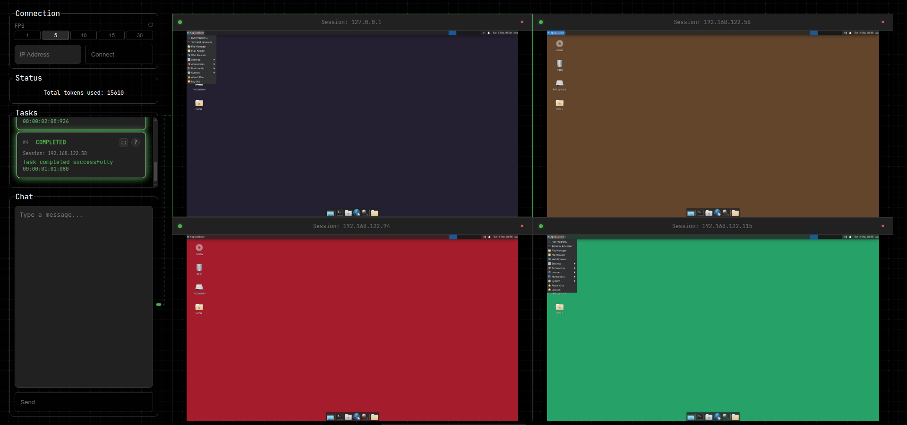
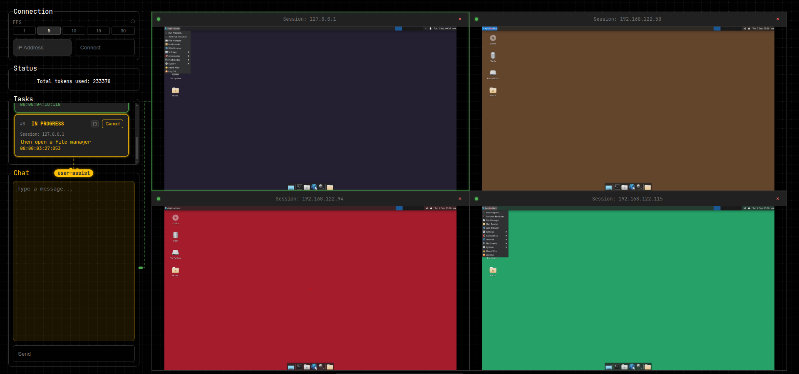
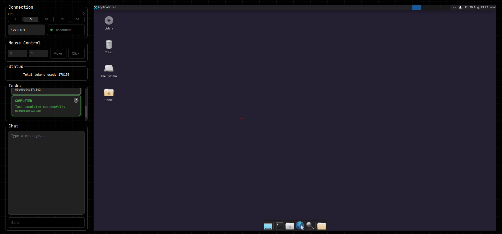

# Changelog

### Unreleased

#### Features
* Added a **Kill switch** at the bottom of the Workspaces sidebar: after a confirmation dialog it cancels every queued, running, and paused task across all workspaces (including tasks only visible on the session servers) and reports how many were canceled, how many had already stopped, and how many failed.
* Added per-session video recording: a `Rec` button with a fat dot in each session header starts/stops recording the session stream at exactly the session's FPS (a 1 FPS session records at 1 FPS, no extra capture or network load). The dot turns into a pulsating red dot with the elapsed time while recording; finished videos are uploaded to the backend and saved as `data/artifacts/session-recording/<start-time>_<session-ip>.webm`.
* Added disposable Docker containers to the Inventory view ("+ Disposable container", Docker Compose only): starts a copy-on-write copy of the `backend` service in about a second and lists it as a highlighted `TEMP` row that can be connected in any workspace; **Destroy** removes the container, its data volume and the inventory entry. Backed by a new `docker-controller` sidecar that is the only service with access to the Docker socket. No setup: the shared token is generated on first start, and each copy starts with a copy of the backend's `config.json`. See `DOCKER_README.md`.
* Sessions now fill the workspace for any number of sessions: rows of equal height, and an incomplete last row is widened (5 sessions are 3 + 2 instead of 3 + 1 + 1).
* The chat-to-session line is routed through free space only (beside the grid, the top margin, the gaps between rows) and takes the shortest route that crosses no other session, instead of running around the outside of the grid and through neighbouring sessions.

#### Bugfixes
* Disposable containers only offered the providers configured through environment variables because their empty `/data` had no `config.json`; they now start with a copy of the backend's config.
* A disposable container could still be connected while it was already being destroyed; its row now turns grey and ignores input until the request finishes, and becomes usable again with an error message if destroying fails.
* Inventory errors from creating or destroying (shown with the add/edit form closed) were not displayed.
* Creating a disposable container failed with "Could not create container: docker-controller returned 500" after the `backend` image was rebuilt: the controller created copies from the image ID stored in the running backend container, which Docker had already replaced and removed. It now uses that ID only while the image still exists and otherwise falls back to the image reference the service was created from (the rebuilt image). The backend also did not read the controller's error body, so the real cause (`No such image`) was hidden behind a generic 500; the message is now shown.
* Removed the arbitrary cap of 8 disposable containers at once (and the `MAX_CONTAINERS`/`DISPOSABLE_MAX_CONTAINERS` setting): creation is no longer limited by the controller.

### v0.3.1

#### Changes
* Redesigned the outer App Shell (left navigation sidebar, workspaces sidebar, and workspace preview stage) and Inventory view with a unified obsidian/graphite/gold visual system, SVG icons, item count badges, refined empty states, and improved card/form layouts.

#### Bugfixes
* Deleting a workspace now first cancels all of its queued, running, or paused tasks via each session's `/task-cancel` endpoint; the workspace is only deleted after every cancellation succeeds, otherwise the delete confirmation dialog stays open and shows an inline error.
* Preserved per-workspace LLM model/provider/thinking-level selection and task list scroll position across workspace switches (in both normal and user-assist modes).
* Fixed user-assist task card restoration and SVG connection lines (chat-to-session and user-assist badge-to-task) across workspace switches, zoom transitions, preview hover scaling, and task list scrolling.

### v0.3.0

#### Features
* Added single-file SQLite persistence (`useless-agent.db`) for user accounts, 7-day auth sessions, workspaces, sessions, tasks, per-workspace metrics/settings (FPS, token usage, network usage), and server inventory.
* Added dark-themed Login / Register page with salted `bcrypt` password hashing and 7-day persistent authentication (`localStorage` + `HttpOnly` cookie) for instant re-entry.
* Added outer App Shell with a persistent left sidebar (`Workspaces`, `Inventory`), a secondary Workspaces sidebar (`+ New workspace`, workspace list with session/active-task indicators, delete confirmation modal, and persisted last-selected workspace per user), and a zoomed-out workspace preview stage with rounded corners, hover zoom reaction, left-click expand, and `Alt+W` zoom toggle.
* Added automatic live task synchronization (`/execution-state`) on login, workspace activation, and session WebSocket connect to prevent hidden/runaway tasks.
* Added Inventory management view (add, edit, delete, filter, and quick-connect servers) plus a `+` quick-connect dropdown with filter input inside the workspace Connection bar.
* Prevented multiple workspaces from connecting to the same server IP simultaneously.

#### Bugfixes
* Fixed X11 `CaptureX11Screenshot` writing `0x00` padding byte as PNG alpha (making desktop backgrounds transparent) by setting opaque `A: 255`.
* Preserved per-workspace Settings open/closed state, selected Settings tab, FPS selection, token/network usage, and user-assist state (gold border + gold connection line) across workspace switches and zoom transitions.
* Fixed chat-to-session and user-assist SVG connection lines and session selection borders when zoomed out.
* Prevented workspace hotkeys from firing while typing in any input/filter field (while keeping `Esc` to blur/close).

### v0.2.0

#### Features
* Redesigned the Settings -> Execution Engine tab with React-rendered status task boxes at the top and a centered, auto-scrolling vertical timeline below (executed items above, active item highlighted at the vertical center pointer, and planned items muted below, with manual-scroll pause and `FOLLOW LIVE` resume).
* Added dual-stack IPv4 and IPv6 support across backend, frontend, and Docker (including mixed IPv4/IPv6 sessions and automatic IPv4 fallback when IPv6 is disabled).
* Added LLM provider support for Google Gemini, OpenAI, Anthropic, Qwen, and MiniMax.
* Added dynamic model and thinking level selection, displaying `model · effort` on task cards.
* Added optional JSON configuration file support (`config.example.json`).
* Added persistent storage for settings and state.

#### Bugfixes
* Fixed real-time Execution Engine updates and instant session switching: fixed stale WebSocket handler closures, scoped incoming events by session, aborted stale `/execution-state` fetches on session switch, and fixed backend `/execution-state` JSON serialization (`Context`/`CancelFunc`) with live subtask/action snapshots.
* Restored toast error notifications for failed connections: entering an unreachable IP (or opening a task-card session whose backend is unreachable) now shows a bottom-right "Cannot connect" alert once per session, alongside the existing red chat-box flash.
* Fixed premature main-goal completion caused by JSON array truncation in `BreakGoalIntoSubtasks`, and added explicit main-goal verification and replanning (`IsMainGoalAchieved`, `ReplanSubtasks`).
* Fixed out-of-order WebSocket task status updates and queue state races that could leave newly started tasks stuck in `in-the-queue` or `in-progress`.
* Omitted unsupported `presence_penalty` parameter for the Gemini provider.
* Removed fixed `max-height` on the frontend tasks container.
* Cleaned up stale `/tmp/.X2-lock` and `/tmp/.X11-unix/X2` files on container startup so `Xvfb` restarts reliably.

#### Changes
* Refactored the execution engine (`Engine`) to use callback-driven subtask/task verification (triggering verification only when `stopIteration` is signaled, removing arbitrary sleep delays), guaranteed terminal status reporting, and context-propagated LLM calls.
* Refactored action execution to a registry-based executor with a compact JSON action format to reduce token usage while keeping human-readable logs and UI updates.
* Preferred X11/EWMH API for window detection and hardened the visual fallback.
* Optimized Docker builds with multi-stage parallel backend builds, BuildKit cache mounts (`apt`, Go/CGO, `npm`), fixed Go module layer caching, and added `frontend/.dockerignore`.
* Updated Go, npm, and Docker dependencies.
* Cleaned up `README.md` and moved release notes into `CHANGELOG.md`.

### v0.0.3
* User-assist feature works.
* Faster task cancellation.
* Extract css and js from the html file.
* Fixed routing of the line which connects chat and session window.
* Fixed media buttons overlay resizing.
* Tasks destined to the same session now queued.
* Use more API of the environment where it's possible.
* Break main.go into separate packages.
* Other small fixes.

### v0.0.2

* Manage multiple sessions at once.
* Fullscreen & maximize control elements for the video stream. Hotkeys F and M.
* Added a button to the task card to reopen a session window.
* MVP of the user-assist feature, only UI for now.
* Smart scrolling for the tasks section.
* Many small UI bugfixes and improvements.

Multi-session

User-assist

### v0.0.1

* Added basic tasks management and status indication.
* Hotkeys support.
* UI update.
* Video stream FPS selector.

