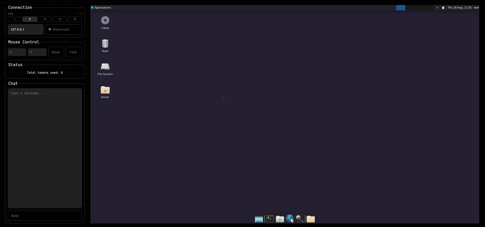
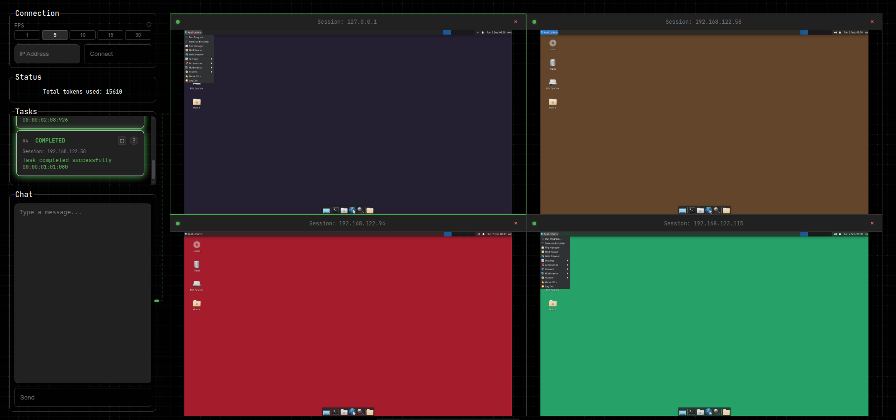
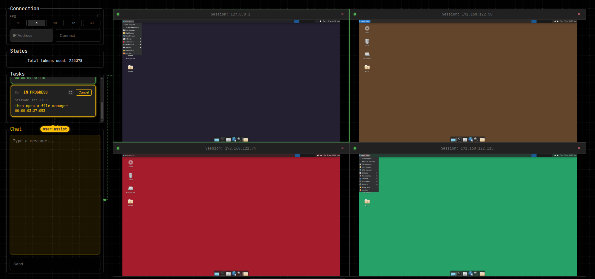

# useless-agent 



**What can this agent do?** Basically nothing, that’s why it is the useless-agent.  

**Why is it interesting?**  

* Uses text-only LLMs.  
* Cheap: I spent about $4.57 playing with it for about 7 evenings.  
* Single binary. *(almost, see todo list)*  
* Easy to use: run the binary and copy the IP address.  
* No telemetry, no bullshit.
* IPv4 & IPv6

**:star: Would you like me to work more on this project? Please consider giving this repository a star!**  

> [!CAUTION]  
> * Only use this on a disposable virtual machine.  
> * It can, and most likely will, destroy your system.  
> * The LLM API provider has a realistic ability to inject malicious commands/actions/data into the ingested API responses.  
> * The video is not compressed. If you are connected to a virtual machine in the cloud, be aware of high internet traffic.  
> * The video stream and everything else, except the API queries, are not encrypted. If connecting to a remote machine, use an SSH tunnel with port forwarding.  

> [!NOTE]  
> It is super slow. Right now, speed is not a priority. If your only problem is speed, you have already won the agents game.  

Currently supported llm providers:
* `DeepSeek` (`deepseek`)
* `Z.AI` (`zai`)
* `Google Gemini` (`gemini`)
* `OpenAI` (`openai`)
* `Anthropic` (`anthropic`)
* `Qwen.AI` (`qwen`)
* `MiniMax` (`minimax`)

Currently supported models:
* DeepSeek: `deepseek-flash`, `deepseek-v4-pro`
* Z.AI: `glm-5.3`, `glm-5.3-flash`, `glm-5.3-flashx`, `glm-5.2`, `glm-4.7-flash`
* Google Gemini: `gemini-4-carbon`, `gemini-4-neon`, `gemini-4-hydrogen`, `gemini-4-argon`
* OpenAI: `gpt-6.2-astra`, `gpt-6.2-sol`, `gpt-6.1-terra`, `gpt-6-luna`
* Anthropic: `claude-fable-5-2`, `claude-opus-5-5`, `claude-sonnet-5-5`, `claude-haiku-5-5`
* Qwen.AI: `qwen4-max`, `qwen3.8-max`, `qwen3.8-flash`, `qwen3.7-plus`
* MiniMax: `MiniMax-M3.1-Flash`, `MiniMax-M3`

**Environment**: Only works on - `Linux + xfce + X11`.  

# Donations 

Support the project.
All tokens will be converted into LLM tokens.
* Bitcoin Native Segwit `bc1q776stw2zg92yfuugtn82wmfxtfe69kyewgz2ne`
* Ethereum `0x435d6c084df6Ad32371A59B994ACC11ab71Bc5Ed`
* Solana `Hp1fPB1k551sNAhHzU2o18w54mQYSncC8wBWMLW868Y6`
* BNB Chain `0x435d6c084df6Ad32371A59B994ACC11ab71Bc5Ed`
* Bitcoin Taproot `bc1pua843feaphhlm6rsgrpynz235e3lg8nsqznwg00nfn5nt4fc5haqce725q`

# Features


<p align="center">Multi-session</p>


<p align="center">User-assist</p>

For version history, see [CHANGELOG.md](CHANGELOG.md).

# Q&A
* Can I put something like `http://127.0.0.1:11434/v1` into `API_BASE_URL=''` and use a model that I run locally? - Yes.

# Demos

`Prompt`: Open a web browser and go to deepseek.com

https://github.com/user-attachments/assets/6299f1b5-3c2e-493e-b67a-145487e14ffa

`Prompt`: Very detailed prompt to create a ping pong tcp client and server(neovim)

https://github.com/user-attachments/assets/370bdd7e-0955-4b1e-8e81-8ee3eb913e90


### How to build:

**The easiest way:**
```bash
docker compose up --build
```

For more information, see [DOCKER_README.md](DOCKER_README.md).

> [!WARNING]
> Docker is not a sufficient level of isolation and it is risky.

**or manually:**
* `git clone`
* `cd useless-agent`
* `go build`

### How to prepare headless vm:
Scripts - "assets/scripts"
```bash
sudo apt update && sudo add-apt-repository ppa:alex-p/tesseract-ocr5 && sudo apt install -y \
  xfce4 xvfb tesseract-ocr-eng tesseract-ocr libtesseract5 libleptonica-dev libtesseract-dev
sudo apt remove -y xfce4-screensaver
sudo systemctl enable --now xvfb.service xfce4.service
```

### How to establish a secure tunnel between client and remote server:
```bash
ssh -p 22 -fN -o IPQoS=ef USERNAME@REMOTE-HOST-PUBLIC-IP -L 127.0.0.1:8080:127.0.0.1:8080
```

### How to use:
`copy executable to the target machine`

#### Configuration (`data/config.json`)
You can configure multiple LLM providers and switch models from the UI using `data/config.json`:
1. On first run inside the `useless-agent` directory (or via Docker Compose), the backend automatically creates `data/logs/`, `data/artifacts/`, and a starter `data/config.json` (without overwriting any existing data).
2. Or copy [config.example.json](config.example.json) to `data/config.json` and fill in your provider API keys.
3. Optional flags / environment variables:
   - `--data-dir` / `DATA_DIR` — persistent data directory (default: `./data`)
   - `--config` / `CONFIG_PATH` — path to `config.json` (default: `<data-dir>/config.json`)
   - `--session-logs` — enable/disable persistent session logs in `<data-dir>/logs` (default: `true`)

CLI flags (`--provider`, `--key`, `--model`, `--base-url`) remain supported and override `config.json` for the specified provider.

`start executable:`
```bash
./useless-agent --provider=deepseek --base-url="https://api.deepseek.com/v1" --key=YOUR-API-KEY --model='deepseek-flash' --display=:1 --ip=127.0.0.1 --port=8080
./useless-agent --provider=zai --base-url="https://api.z.ai/api/paas/v4" --key="YOUR-API-KEY" --model='glm-5.3-flash' --display=:1 --ip=127.0.0.1 --port=8080
./useless-agent --provider=gemini --base-url="https://generativelanguage.googleapis.com/v1beta/openai/" --key="YOUR-API-KEY" --model='gemini-4-neon' --display=:1 --ip=127.0.0.1 --port=8080
./useless-agent --provider=openai --base-url="https://api.openai.com/v1" --key="YOUR-API-KEY" --model='gpt-6.2-sol' --display=:1 --ip=127.0.0.1 --port=8080
./useless-agent --provider=anthropic --base-url="https://api.anthropic.com/v1/" --key="YOUR-API-KEY" --model='claude-sonnet-5-5' --display=:1 --ip=127.0.0.1 --port=8080
./useless-agent --provider=qwen --base-url="https://dashscope-intl.aliyuncs.com/compatible-mode/v1" --key="YOUR-API-KEY" --model='qwen4-max' --display=:1 --ip=127.0.0.1 --port=8080
./useless-agent --provider=minimax --base-url="https://api.minimax.io/v1" --key="YOUR-API-KEY" --model='MiniMax-M3.1-Flash' --display=:1 --ip=127.0.0.1 --port=8080
```
`On client machine open main.html in the browser.`

`Put target machine IP into the field "IP Address".`

`Click "Connect".`

`Give it some task, for example "Open web browser", put that prompt into the LLM Chat and press "Send".`

> [!TIP]  
> Like to burn money? Try more capable LLMs; using DeepSeek R1 instead of v3 would probably make the program more capable of doing nothing.

### Todo list:  
- [ ] Build a single fully static binary.  
- [X] Add stats about burned tokens.
- [ ] Allow LLM to spawn local 'thoughts', which would do/monitor something and then allow them to interrupt the main LOOP and to inject its results into the thinking loop.
- [ ] Build a unified concept space for models that are capable of ingesting more data.
- [ ] Pause task execution.
- [X] Allow intervention in the execution process and provide guidance/additional instructions.

**Problems & Ideas:**  
* LLMs' context window/input size is so limiting; I want to shuffle in 100M million tokens at each iteration.  
* How to do reliable OCR? Don’t do it at all. The idea was to find a single point where Linux renders fonts for the whole system and intercept it, to set something like an eBPF hook and get all text for free. `Turns out there is no single point of font rendering in Linux!` Each X11 client app is allowed to render fonts itself.  
* How hard could it be to write a single function to recognize windows? They have unified patterns, right? `Wrong. Each window is allowed to draw its own header however they like.` I’m looking at you, Firefox. 
